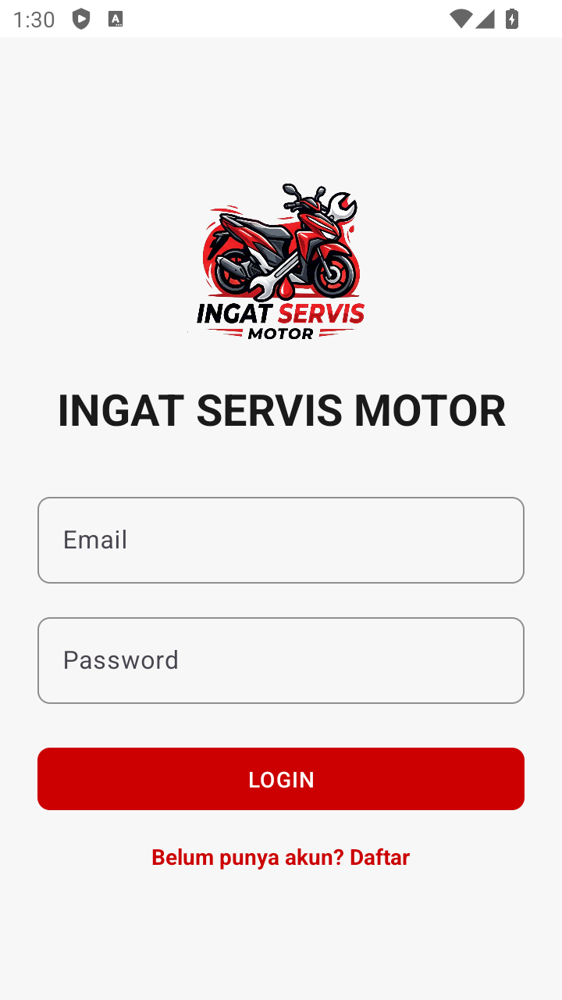
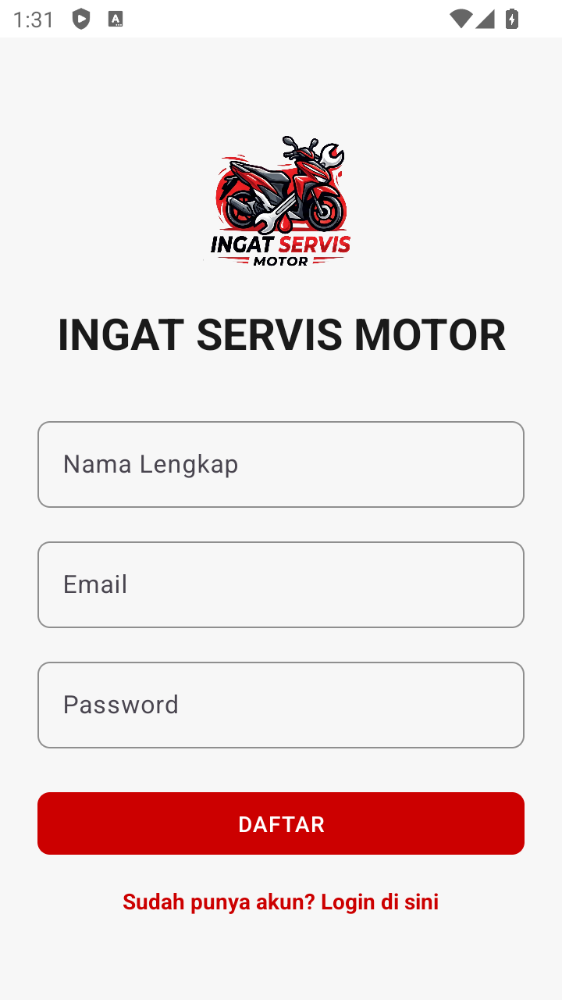
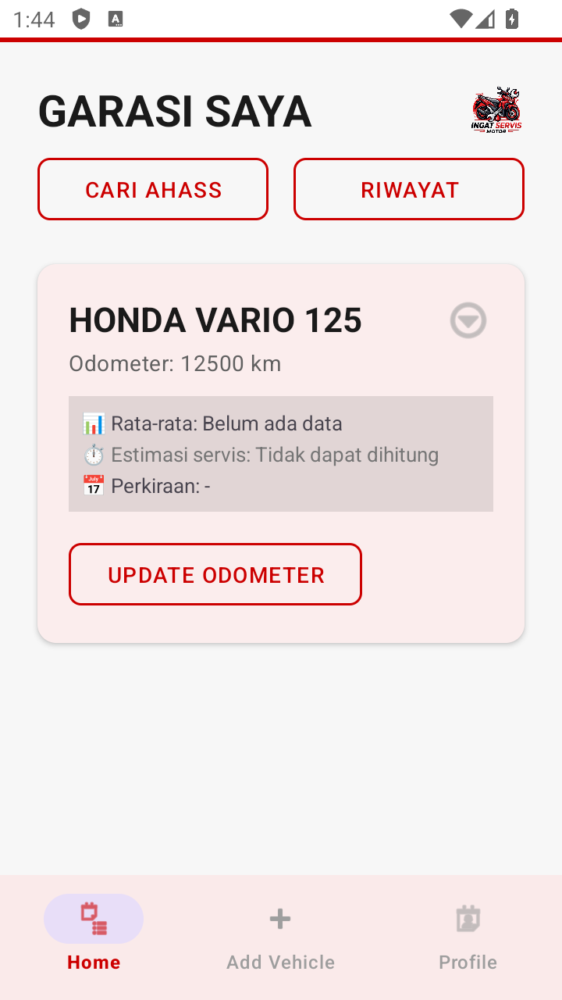
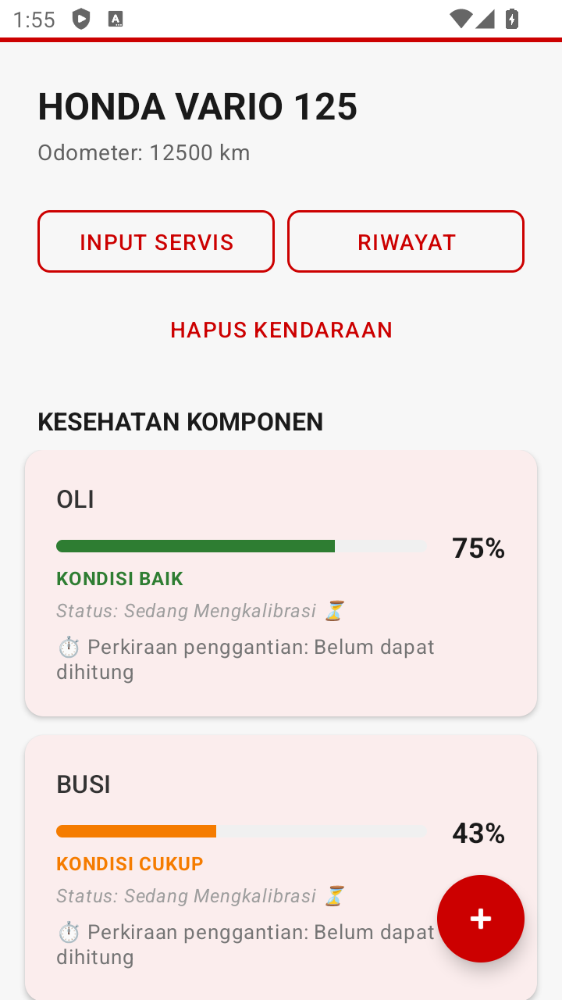
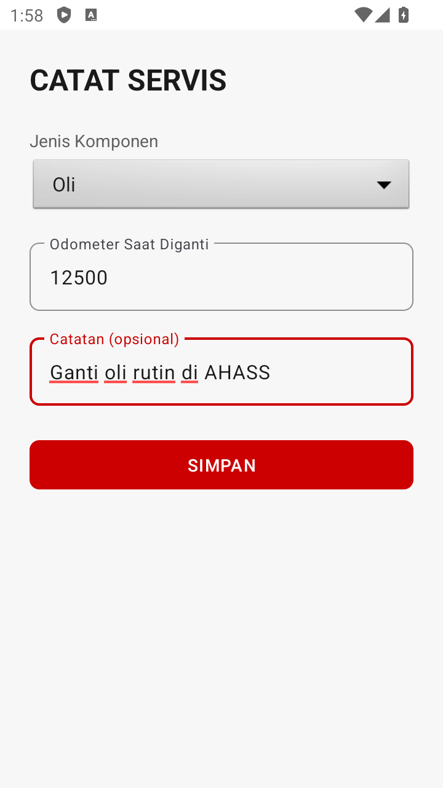
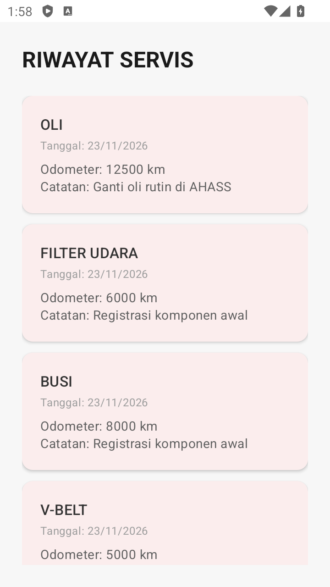
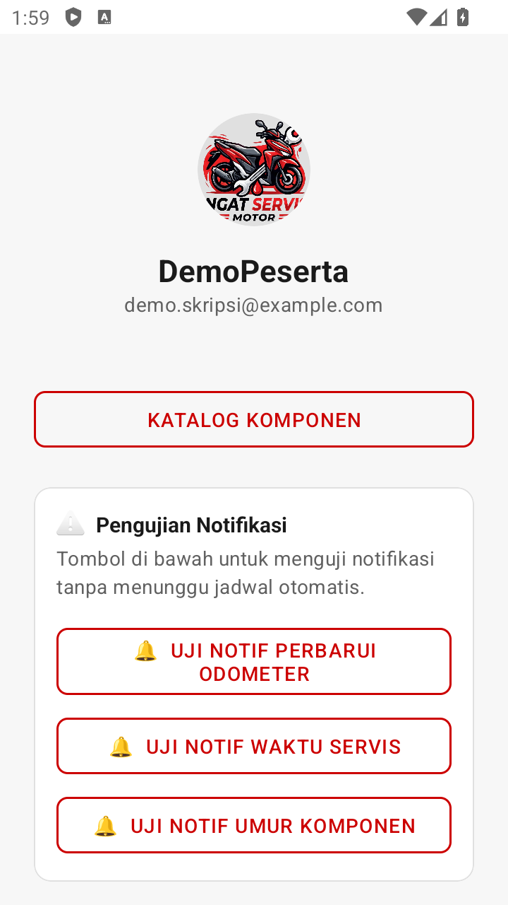
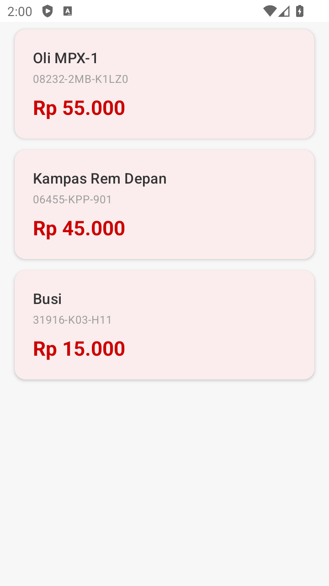

# Ingat Servis Motor 🏍️

Aplikasi Android native (Kotlin) untuk membantu pemilik sepeda motor Honda (≤250cc) mengingat dan mencatat perawatan rutin: pelacakan umur komponen *fast-moving*, notifikasi proaktif, riwayat servis, katalog part, dan pencarian bengkel AHASS terdekat.

> Proyek **Skripsi** — Program Studi Teknik Informatika, Universitas IIB Darmajaya.
> Penulis: **Johanes Andika** (NPM 2211010069).

---

## ✨ Fitur

| Fitur | Keterangan |
|---|---|
| **Autentikasi** | Firebase Authentication (email & password) dengan validasi form |
| **Multi-kendaraan** | Kelola beberapa motor sekaligus, dikelompokkan per tipe: bebek, matic, sport |
| **Pencatatan odometer** | Input odometer manual + perhitungan rata-rata km/hari (SMA & delta odometer) |
| **Component Health** | Estimasi sisa umur pakai komponen dalam persen, lengkap dengan status (aman / mendekati / lewat) |
| **Reminder otomatis** | WorkManager (`ServiceReminderWorker`, `SundayWorker`) untuk cek komponen dan kirim notifikasi |
| **Riwayat servis** | Log penggantian komponen per kendaraan dengan tanggal & odometer |
| **Katalog part** | Daftar part beserta harga referensi per model motor |
| **Cari AHASS** | Intent ke Google Maps untuk bengkel AHASS terdekat (`geo:` URI + fallback web) |
| **Profil** | Data pengguna, kendaraan terdaftar, pengaturan komponen yang dilacak |

### Interval penggantian komponen yang dipakai

| Komponen | Interval |
|---|---|
| Oli | 2.000 km |
| Oli Gardan | 8.000 km |
| Busi | 8.000 km |
| Filter Udara | 16.000 km |
| V-Belt (matic) | 24.000 km |
| Rantai (bebek/sport) | 24.000 km |

---

---

## 📱 Tampilan Aplikasi

Screenshot diambil dari build **release v1.0** di emulator Android 14 (API 34), 720×1280.

| Login | Registrasi | Dashboard (Garasi) |
|:--:|:--:|:--:|
|  |  |  |

| Detail Kendaraan — Component Health | Catat Servis | Riwayat Servis |
|:--:|:--:|:--:|
|  |  |  |

| Profil & Uji Notifikasi | Katalog Komponen |
|:--:|:--:|
|  |  |

> Data pada screenshot adalah data uji (akun demo, Honda Vario 125, odometer 12.500 km).

---

## 🧱 Tech Stack

- **Bahasa:** Kotlin
- **Min / Target SDK:** 24 / 36 (compileSdk 36, AGP + Gradle 9.4.1, JDK 21)
- **Arsitektur:** Activity + ViewModel-oriented (pola MVVM, Clean Architecture principles)
- **UI:** ViewBinding, Material Components, ConstraintLayout, tema gelap bergaya motorsport (lihat `docs/DESIGN.md`)
- **Backend:** Firebase Authentication + Cloud Firestore (real-time + offline support)
- **Background job:** AndroidX WorkManager
- **Build:** Gradle Kotlin DSL (`build.gradle.kts`) dengan version catalog (`gradle/libs.versions.toml`)

---

## 🚀 Menjalankan Proyek

### Prasyarat
- **Android Studio** (Ladybug/Meerkat atau lebih baru)
- **JDK 21**
- **Android SDK Platform 36** + Build Tools

### Langkah
```bash
git clone https://github.com/J-Andika/ingatservismotor.git
cd ingatservismotor

# buat local.properties berisi path SDK kamu
echo "sdk.dir=/path/to/Android/Sdk" > local.properties

# build debug APK
./gradlew assembleDebug
# hasil: app/build/outputs/apk/debug/app-debug.apk
```
Atau buka folder ini langsung di Android Studio lalu **Run ▶**.

### Konfigurasi Firebase
Proyek ini memakai Firebase, jadi butuh `app/google-services.json`:
1. Buat project di [Firebase Console](https://console.firebase.google.com/).
2. Tambahkan Android app dengan package name `com.JohanesAndika.ingatservismotor`.
3. Aktifkan **Authentication → Email/Password** dan **Cloud Firestore**.
4. Unduh `google-services.json` → taruh di folder `app/`.
5. Buat index/collection Firestore: `users/{uid}/vehicles`, `users/{uid}/logs`.

> ⚠️ `google-services.json` yang ada di repo ini milik project Firebase penulis dan memang bersifat *client-side* (ikut tertanam di APK). Kalau kamu memakai project sendiri, **ganti file tersebut**. Pastikan **Firestore Security Rules** ketat (`request.auth.uid == userId`) karena API key client tidak menjaga data.

---

## 📁 Struktur Proyek

```
ingatservismotor/
├── app/
│   ├── src/main/java/com/JohanesAndika/ingatservismotor/
│   │   ├── App.kt                       # Application class + inisialisasi
│   │   ├── LoginActivity.kt / RegisterActivity.kt
│   │   ├── MainActivity.kt              # Dashboard + bottom nav
│   │   ├── AddVehicleActivity.kt / VehicleDetailActivity.kt
│   │   ├── InputLogActivity.kt / HistoryActivity.kt
│   │   ├── CatalogActivity.kt / ProfileActivity.kt
│   │   ├── CalculationUtils.kt          # Rata-rata km, umur komponen
│   │   ├── LocationUtils.kt             # Intent ke Maps (AHASS)
│   │   ├── ServiceReminderWorker.kt / SundayWorker.kt
│   │   ├── VehicleModel.kt              # Vehicle, MaintenanceLog
│   │   └── *Adapter.kt                  # RecyclerView adapters
│   ├── src/main/res/                    # layout, drawable, values
│   └── build.gradle.kts
├── docs/
│   ├── screenshots/                     # Screenshot aplikasi (README)
│   ├── DESIGN.md                        # Design token & panduan visual
│   └── QA-REPORT.md                     # Laporan QA & rencana perbaikan
├── gradle/libs.versions.toml
└── .github/workflows/android.yml        # CI: build debug APK + unit test
```

---

## 🔄 CI/CD

Workflow `.github/workflows/android.yml` jalan di setiap push/PR ke `main`:
`./gradlew assembleDebug` → `testDebugUnitTest` → upload APK sebagai artifact GitHub Actions.

---

## 📦 Download APK

Build siap-pakai (signed release) tersedia di halaman **[Releases](https://github.com/J-Andika/ingatservismotor/releases/latest)**:
`ingatservismotor-v1.0.apk` — minSdk 24 (Android 7.0+), ukuran ± 10,5 MB.

APK ditandatangani dengan keystore rilis **lokal** yang tidak di-commit ke repo
(`.keystore/`, `keystore.properties` ada di `.gitignore`). Untuk build release sendiri:

```bash
# 1. buat keystore
keytool -genkeypair -v -keystore .keystore/release.jks -alias <alias> \
        -keyalg RSA -keysize 4096 -validity 10000

# 2. isi keystore.properties (root project)
#    storeFile=.keystore/release.jks
#    storePassword=...
#    keyAlias=<alias>
#    keyPassword=...

# 3. build
./gradlew assembleRelease
# hasil: app/build/outputs/apk/release/app-release.apk
```
Kalau `keystore.properties` tidak ada (mis. di CI), build release tetap jalan tetapi APK-nya unsigned.

---

## 📄 Lisensi

[MIT](LICENSE) © 2026 Johanes Andika
